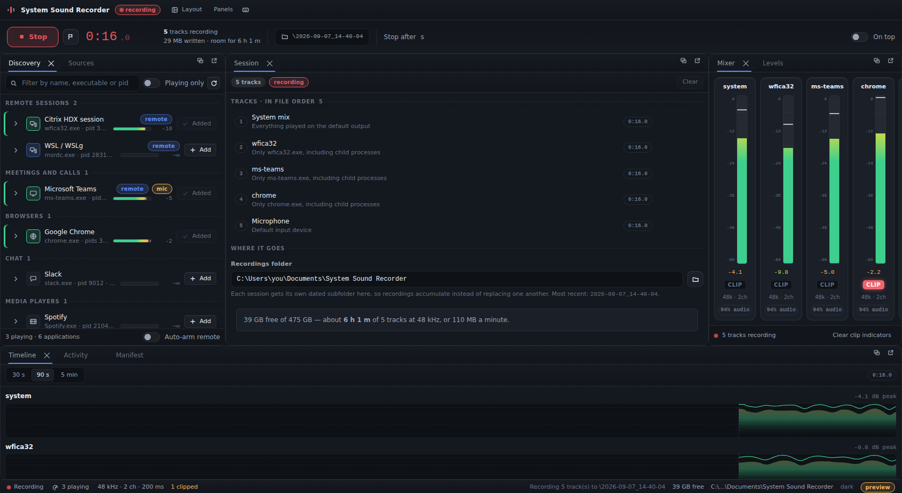
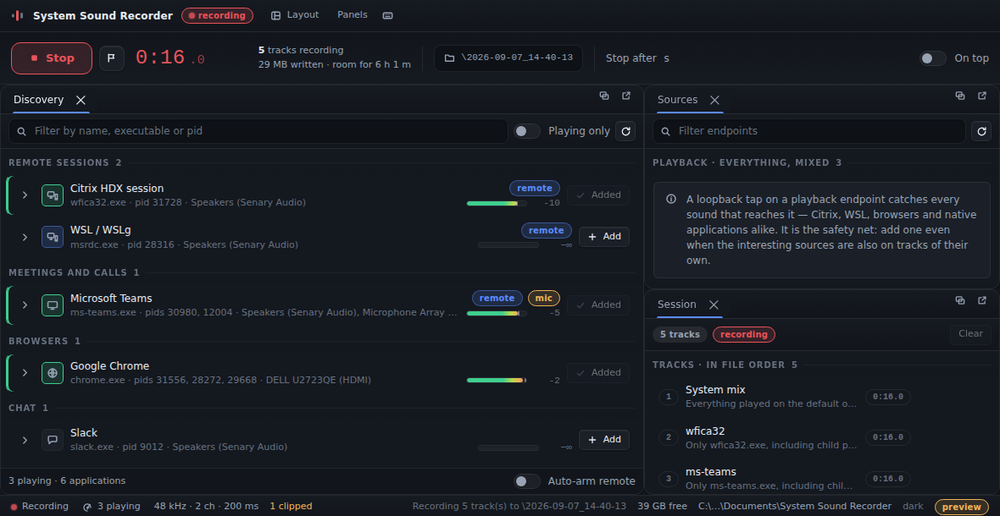
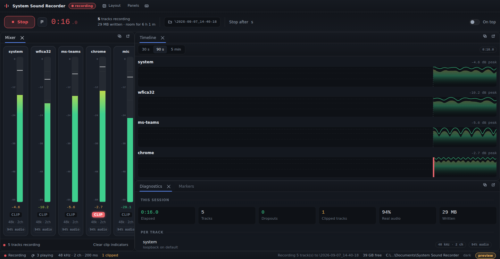

# System Sound Recorder

**Records every audio stream reaching a Windows machine.** Citrix HDX sessions,
WSL applications, browsers, chat clients and native programs — as one mixed
file, or as separate tracks that line up with each other to the millisecond.

[](https://github.com/ivasik-k7/system-sound-recorder/actions/workflows/ci.yml)
[](https://github.com/ivasik-k7/system-sound-recorder/actions/workflows/release.yml)
[](LICENSE)
[](#requirements)
[](#building-from-source)



Most recorders capture one device and hope for the best. Two problems make that
unusable, and both are solved here: a quiet endpoint delivers no buffers at all,
so naive recorders silently delete every silence; and every endpoint counts time
with its own oscillator, so tracks recorded side by side drift apart. This one
manufactures silence from timestamps and places every buffer against a single
shared origin. Measured, a system mix and a per-process track recorded together
ended **one frame apart**.

---

## Contents

- [Install](#install) · [Quick start](#quick-start) · [Requirements](#requirements)
- [Why one tap catches everything](#why-one-tap-catches-everything)
- [What makes it accurate](#what-makes-it-accurate)
- [Finding what to record](#finding-what-to-record)
- [The interface](#the-interface)
- [Transcription](#transcription)
- [Commands](#commands)
- [Output](#output)
- [Building from source](#building-from-source)
- [Project status](#project-status)
- [Recording other people](#recording-other-people)
- [Licence](#licence)

## Install

Download from the [latest release](https://github.com/ivasik-k7/system-sound-recorder/releases/latest):

| File | For |
|---|---|
| `System-Sound-Recorder-<version>-setup.exe` | Most people. Installs the desktop application. |
| `System-Sound-Recorder-<version>-x64.msi` | Deployment through group policy or Intune. |
| `ssr-<version>-x86_64-pc-windows-msvc.zip` | The command line recorder on its own. |

Verify a download against `SHA256SUMS.txt`:

```powershell
Get-FileHash .\System-Sound-Recorder-0.1.0-setup.exe -Algorithm SHA256
```

Releases are built by [GitHub Actions](.github/workflows/release.yml) from a
tagged commit, so the checksums correspond to a build you can read the log of.
Nothing is code-signed yet, so Windows will warn on first run.

### Requirements

Windows 10 1809 or later, or Windows 11. Per-application recording uses process
loopback, which arrived in Windows 10 2004 — on anything older, the system mix
still works. The desktop application needs the WebView2 runtime, which is
already present on Windows 11 and installed by the setup program if it is
missing.

No administrator rights, no driver, and no virtual audio device.

## Quick start

```powershell
ssr discover                       # what is making sound right now
ssr rec --system                   # everything, mixed
ssr rec --app wfica32.exe --mic    # the Citrix session and your voice, separately
ssr rec --system --app ms-teams.exe   # the mix and the meeting, side by side
```

Recording stops on Ctrl-C, or after `--duration`. Each run writes a dated
folder containing one WAV per track and a `session.json` describing them.

## Why one tap catches everything

Citrix redirects remote session audio to the local Windows playback endpoint.
WSLg pipes Linux PulseAudio over RDP into the same audio engine. Browsers and
native applications go there directly. Everything converges in the Windows audio
engine, so a loopback capture there records all of it, and per-process loopback
splits it apart again.

```
  Citrix (wfica32.exe) ─┐
  Browser, Teams, Slack ┤
  WSL / WSLg (msrdc) ───┼──► Windows audio engine ──► playback endpoints
  Native applications ──┘             │                        │
                                      │                        │
   ssr                                │                        │
    ├─ endpoint loopback  ◄───────────┼────────────────────────┘   everything, mixed
    ├─ process loopback   ◄───────────┘                            one application
    └─ input capture      ◄─ microphones
```

## What makes it accurate

Two problems make naive recorders unusable, and both are solved here.

**Idle gaps.** A loopback stream on a quiet endpoint delivers no buffers at all.
Appending buffers as they arrive silently deletes every silence, so ten minutes
of occasional notification sounds comes back as four seconds of beeps. Silence
is manufactured from the timestamps instead.

**Independent clocks.** Every endpoint counts time with its own oscillator, so
tracks recorded side by side drift apart. Each buffer is placed by the
performance counter timestamp it carries, against one origin shared by the whole
session.

Measured on the development machine with `scripts/verify-session.py`: a system
mix track and a single-process track, recorded together for ten seconds, ended
one frame apart and aligned to about 5 ms. That residual is real pipeline
latency rather than drift, and it has the right sign, since the per-process tap
sits upstream of the endpoint mix. A 440 Hz reference tone came back at
440.000 Hz on the isolated track.

Measure it yourself:

```bash
python3 scripts/verify-session.py recordings/meeting --tone 440
```

## Finding what to record

Every stream reaching an endpoint is a Windows *audio session*, and they can be
enumerated. So rather than matching a list of executable names, the recorder
asks the audio engine what exists — which process owns each stream, whether it
is active, and its live level, per channel.



```bash
ssr discover --watch
```

```
  * ############..   -9.4  --app Zoom.exe             Zoom
      playing, 3 session(s), pids 11796, 17280 → Speakers, Microphone Array
  * ..............   -inf  --app wfica32.exe          Citrix HDX session
      idle, 1 session(s), pid 31728 → Speakers
  * ..............   -inf  --app msrdc.exe            WSL / WSLg
      idle, 1 session(s), pid 28316 → Speakers
```

Two things follow that name matching cannot do. An application nobody
catalogued is found anyway, because it has a session. And an application that
is merely *running* is visibly distinct from one that is *playing*, so a Citrix
client sitting idle is not offered as though it were live.

The same pass reads each endpoint's channel layout, which is not a preference
but a fact: a shared-mode loopback capture has to use the endpoint's mix
format, so this is what the recorded file will contain.

```bash
ssr devices
```

```
  * Speakers (Senary Audio)
      48000 Hz  32-bit float  Stereo  [L R]
      Speakers · Senary High Definition Audio
    DELL U2723QE (HDMI)
      48000 Hz  32-bit float  5.1  [L R C LFE Lss Rss]
```

Discovery is cheap enough to drive a meter. A refresh reads a state and a set
of channel peaks per session, about 3 ms on the development machine; the full
rescan that notices newly started streams happens roughly once a second and
costs about 45 ms. See [docs/architecture.md](docs/architecture.md) for why it
is not simply re-enumerated each time.

## The interface

Twelve panels in a real docking workspace: drag them between groups, tab them
together, float them over the window, or tear one off onto a second display.
The arrangement is saved as it changes.



Six arrangements are named, because the layout that suits setting a session up
is not the one that suits watching it run for two hours.

| Arrangement | For |
|---|---|
| Console | Everything at once. The default |
| Setup | Deciding what to record, with discovery given room to read |
| Monitor | A running session: mixer and level history, large |
| Diagnostics | Working out why a recording is not what it should be |
| Library | Finding a recording made earlier |
| Minimal | The plan and the levels, in a small window |

Any arrangement you build yourself can be saved under a name. `Ctrl+K` opens a
command palette listing every action, panel and arrangement.

The panels worth naming:

- **Discovery** — everything making sound, grouped, with live levels and
  per-channel detail. One click arms a source; remote sessions can arm
  themselves the moment one starts playing.
- **Sources** — endpoints with their resolved formats and named channels, so
  what a track will contain is visible before recording it.
- **Mixer** — a vertical strip per track, which is how you notice that one of
  eight tracks has quietly gone dead.
- **Timeline** — level history with markers, the average as an area and the
  peak as a line above it.
- **Diagnostics** — dropouts, how much of each track was manufactured silence,
  what the free space is worth in minutes, and what discovery costs.
- **Library** — past sessions, and whether each one finished. A folder with
  WAVs but no manifest was interrupted, and is labelled as such.

The meters have real ballistics: the bar follows the average, a hairline
follows the instantaneous peak, and a mark holds the loudest recent peak before
falling away — without which a transient that clipped the recording occupies
one frame and is never seen. The clip indicator latches and stays lit until it
is cleared, because a clipped recording cannot be repaired afterwards.

Four themes, three densities, and five accent colours. Record and clipping stay
red whatever the accent is set to, because those two colours mean something.

## Transcription

Recorded tracks can be turned into text, and a channel can be transcribed while
it is playing. The advantage of doing it here is that the recorder already knows
which track is which, so a meeting captured as a Citrix track and a microphone
track transcribes into two transcripts that are already attributed.

```bash
ssr transcribe recordings/2026-09-07_14-05-11    # a finished session
ssr listen --app wfica32.exe                     # live, as a conversation
```

Recognition uses a speech engine installed on your own machine — none is
bundled, and `ssr transcribe --help` reports what it found and what to install
if it found nothing. **The audio does not leave the machine.** A transcript is
often more sensitive than the audio, because it is searchable; see
[LEGAL.md](LEGAL.md).

## Commands

| Command | What it does |
|---|---|
| `ssr devices` | Endpoints with their formats and channel layouts, defaults marked |
| `ssr apps` | Applications that can be recorded separately, discovered live |
| `ssr discover` | Everything making sound, with levels. `--watch` for a live view |
| `ssr rec` | Record one or more tracks |
| `ssr transcribe` | Turn a finished session into text |
| `ssr listen` | Transcribe a channel while it plays |

Useful `rec` options:

| Option | Effect |
|---|---|
| `--system [DEVICE]` | Everything played, mixed. The safety net. |
| `--app NAME` | One application's audio on its own track. Repeatable. |
| `--not-app NAME` | Everything except that application. |
| `--mic [DEVICE]` | A microphone on its own track. Repeatable. |
| `--duration SECS` | Stop automatically. |
| `--out-root DIR` | Collect sessions here, one dated subfolder each. |
| `--json` | Print the session manifest when finished. |

Useful `discover` options:

| Option | Effect |
|---|---|
| `--watch` | Redraw continuously until interrupted |
| `--sessions` | One row per stream rather than per application, with channel levels |
| `--interval MS` | Refresh rate for `--watch` |
| `--json` | Emit the whole discovery snapshot |

Set `SSR_TRACE=1` to have the engine narrate what it is doing. From WSL that
needs `WSLENV=SSR_TRACE` as well, or the variable will not cross into Windows.

## Output

A session is a directory: one WAV per track plus `session.json`. Tracks are
32-bit float at the endpoint's own rate, all the same length, all starting at
the same instant. The manifest records what each track was, how much of it came
from the device, how much had to be manufactured, any dropouts the audio engine
reported, and any cue points dropped while recording.

Markers go in the manifest rather than staying in the interface, because a cue
point is only worth anything later, in whatever tool the audio is opened with.
Pressing `M` in the desktop application marks the instant; the offset is from
the shared timeline origin, so it is the same moment on every track.

Sessions accumulate rather than replacing one another. Each run creates its own
subfolder named for the local date and time:

```
recordings/
  2026-09-07_14-05-11/    system.wav  wfica32.wav  mic.wav  session.json
  2026-09-07_16-32-49/    system.wav  session.json
```

The desktop application always works this way. On the command line it is the
default, and `--out-root DIR` chooses where they collect. Passing `--out DIR`
instead writes straight into that directory, which does overwrite a previous
session of the same name.

## Building from source

Everything cross-compiles from WSL to Windows with mingw, the desktop shell
included, and the resulting Windows binaries run directly from the WSL prompt —
so `cargo run` and `cargo test` need no wrapper.

```bash
./scripts/bootstrap-toolchain.sh    # once, no root needed
./scripts/build-cli.sh
./target/x86_64-pc-windows-gnu/release/ssr.exe devices
```

Rust 1.85 or later for the engine, 1.88 for the desktop shell, and Node 22 for
the interface.

### The interface, in a browser

```bash
./scripts/dev-ui.sh
```

Open the printed address. Without the desktop shell the interface runs against a
built-in simulator — moving levels, a machine's worth of audio sessions, a
library of past recordings and a filling disk — so layout and behaviour can be
worked on anywhere, which is how the screenshots above were taken.

| Query parameter | Effect |
|---|---|
| `?demo=1` | Start with a session already running |
| `?layout=monitor` | Open straight into a named arrangement |
| `?panel=mixer` | Open one panel alone, as a torn-off window does |
| `?theme=light` | Override the stored theme without changing it |
| `?density=compact` | Override the stored density |

### The desktop application

```bash
./scripts/build-desktop.sh
```

That assembles `dist/desktop`, which can be copied anywhere on the Windows side.
Keep `WebView2Loader.dll` next to the executable: the mingw build links it
dynamically, and without it the program starts and silently does nothing.

This produces the executable but not an installer — bundling an MSI or an NSIS
setup needs the Windows tooling, which is why the installers come from
[CI](.github/workflows/release.yml) instead.

For interface work there is a live loop, with the window on Windows and the dev
server in WSL:

```bash
npm run desktop:dev
```

### Repository layout

```
crates/
  ssr-core        WASAPI capture: endpoint loopback, process loopback, inputs
  ssr-timeline    silence fill, drift-anchored placement, WAV writing, manifests
  ssr-session     session orchestration shared by both front ends
  ssr-transcribe  speech recognition over recorded and live tracks
  ssr-cli         the ssr command line tool
apps/
  ui              React interface, dockable panels, runs in a browser too
  desktop         Tauri shell that hosts the interface on Windows
scripts/          toolchain bootstrap, build helpers, verification
docs/             architecture, plan, toolchain notes
```

The desktop shell is a separate Cargo workspace so that Tauri's dependency set
and target directory stay out of the engine's; see
[docs/toolchain.md](docs/toolchain.md).

### Checks

What CI runs, and what you can run first:

```bash
./scripts/check-versions.sh
cargo fmt --all && cargo clippy --workspace --all-targets -- -D warnings
cargo test --workspace
npm ci && npm run ui:typecheck && npm run ui:build
cargo deny --all-features check
```

[CONTRIBUTING.md](CONTRIBUTING.md) has the rest, including how releases are cut.

## Project status

Pre-1.0 and honest about it. The capture engine, the timeline placement, the
autodiscovery and the interface are built and tested; the accuracy claims above
are measured rather than asserted.

What is deliberately not built yet — a retroactive ring buffer, global hotkeys,
device hotplug recovery mid-recording — is listed with reasons in
[docs/PLAN.md](docs/PLAN.md). [docs/architecture.md](docs/architecture.md)
explains how the parts fit and records the two mistakes that cost the most to
find.

While the version is below 1.0, interfaces including the manifest format may
change between minor versions. See [CHANGELOG.md](CHANGELOG.md).

## Recording other people

Recording a Citrix session or a call captures other people's voices, and in much
of the world that is regulated — sometimes by privacy law, sometimes by criminal
law, and usually by your employment contract as well.

**[LEGAL.md](LEGAL.md) covers what to check before pointing this at a meeting**:
one-party versus all-party consent, the EU and UK data protection position,
Germany's § 201 StGB, what corporate policy typically says regardless of the
law, and the particular questions raised by extracting audio from a remote
session. It is not legal advice, but it says which questions matter.

The short version: tell people, check your employer's policy, and decide before
you start where the file will live and for how long.

**The author accepts no responsibility or liability for how this program is
used, for anything recorded with it, or for any consequence of that recording.**
Establishing that a recording is lawful and permitted, obtaining any consent
required, and looking after the files afterwards are entirely yours. See
[No warranty, and no responsibility for use](LEGAL.md#no-warranty-and-no-responsibility-for-use).

As for the program itself — it has no server, sends nothing anywhere, and
collects nothing about you. [PRIVACY.md](PRIVACY.md) sets out exactly what it
reads, what it writes, and where.

## Licence

Copyright © 2026 Ivan Kovtun. Released under the [MIT License](LICENSE), which
disclaims all warranties and limits liability. Third-party components and their licences, generated from the
dependency graphs, are in [THIRD-PARTY-NOTICES.md](THIRD-PARTY-NOTICES.md);
[deny.toml](deny.toml) is the policy that keeps that list from quietly
acquiring a licence nobody looked at.

Security reports go through
[private vulnerability reporting](SECURITY.md), not a public issue.
